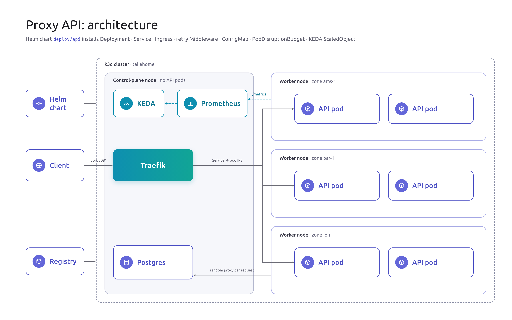
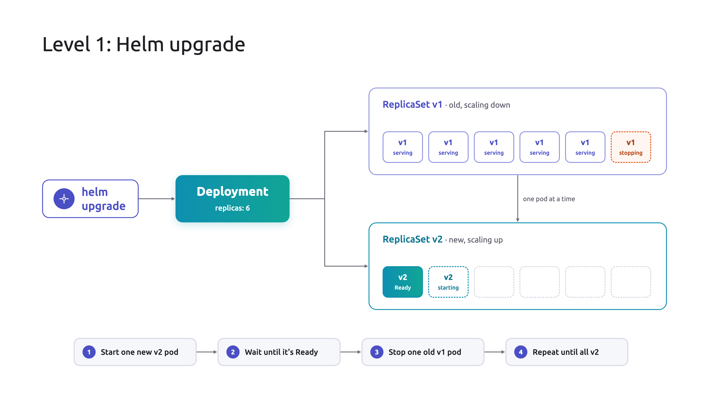
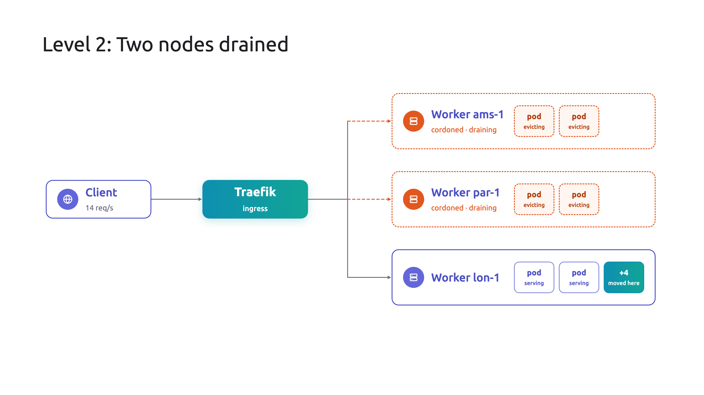
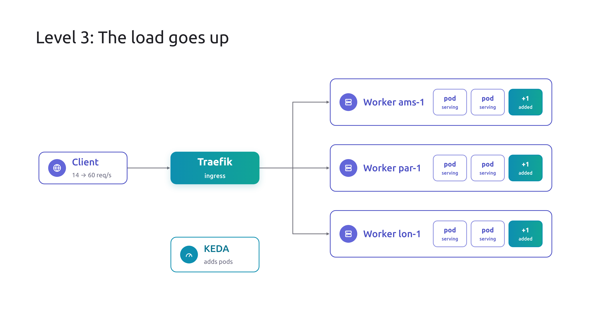
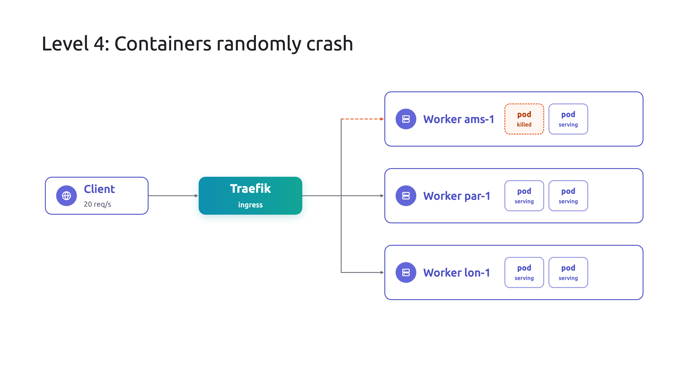

# Proxy API: Helm chart



A Helm chart in [`deploy/api`](deploy/api) that keeps the proxy API answering
through redeployments, node drains, load changes and sudden container
crashes. All four grader levels passed once in each
environment with zero failed requests. Traefik routes straight to the API
pods and replays interrupted requests; KEDA scales the pods on requests in
flight.

Exact settings, logs and older results are in
[`docs/results.md`](docs/results.md). The task brief is in
[`docs/task.md`](docs/task.md).

## Repository structure

```
.
├── Makefile                  # make cluster / setup / check
├── deploy/api/               # The Helm chart (the deliverable)
│   ├── values.yaml           # Shared defaults, with why each value is set
│   ├── development.yaml      # Host and DB user per environment
│   ├── production.yaml
│   └── templates/
│       ├── deployment.yaml   # Probes, preStop, rolling update, zone spread
│       ├── service.yaml
│       ├── ingress.yaml      # Traefik route for GET /proxy
│       ├── retry.yaml        # Traefik buffering middleware (level 4)
│       ├── pdb.yaml          # PodDisruptionBudget (level 2)
│       ├── scaledobject.yaml # KEDA autoscaling on requests in flight (level 3)
│       └── configmap.yaml    # The API's config.yaml
├── local/                    # Local cluster: k3d, Postgres (Terraform), Traefik pin
│   ├── setup.sh              # make setup: Secret copy, Prometheus, KEDA
│   └── addons/               # Pinned Prometheus and KEDA values
├── services/api/             # The API (unchanged)
├── bin/                      # The grader (unchanged)
└── docs/                     # Results, verification logs, task brief, images
```

## Run it

Prerequisites: Docker, k3d, kubectl, Helm, Terraform and make.

```bash
make cluster                    # Local cluster, registry and Postgres
make setup                      # DB Secrets, Prometheus and KEDA
make check ENV=development
make check ENV=production
```

`make setup` copies each environment's DB password Secret from `db` into its
release namespace, then installs pinned Prometheus and KEDA versions on the
control-plane node. Draining workers therefore does not stop autoscaling.
`VALUES` defaults to `deploy/api/$(ENV).yaml`.

Keep the laptop awake and its lid open during checks. On macOS, use
`caffeinate -i make check ENV=development` to prevent idle sleep. If macOS
quarantines the supplied grader, remove that flag with
`/usr/bin/xattr -d com.apple.quarantine bin/check-darwin-arm64`.

## Level 1: deploy under load

### Scenario



- We update the API image with a `helm upgrade`, which triggers a rolling update.
- Startup sequence: the container starts, the health server comes up on 9090, the API pings Postgres until it answers, then it opens port 8080.
- Without probes, Kubernetes treats a pod as ready as soon as its container starts, so Traefik sends traffic to pods that are still booting.
- Kubernetes stops an old pod by sending SIGTERM and removing it from the EndpointSlice at the same time (in parallel).
- On SIGTERM, the API closes port 8080 immediately and only finishes the requests it already has.
- Traefik finds out about the removal about 1.8s later, so it keeps sending requests to the closed port (502).
- If a pod takes too long to shut down, Kubernetes force-kills it after the grace period (default 30s), cutting off any requests still running.

### Failure points and fixes

| Failure point | How we solved it |
| --- | --- |
| 1. Traffic reaches a pod that's still booting | Startup probe on `/db`, which passes only once Postgres has answered and port 8080 is open. Readiness probe on `/status`. A new pod gets no traffic until both pass. |
| 2. Old pod closes its port before Traefik notices (502) | preStop sleep of 15s. The pod keeps serving normally for 15s before it gets SIGTERM, and Traefik stops sending to it after about 1.8s. By the time the port closes, no traffic is arriving. |
| 3. Requests cut off by a force-kill | The API drains in-flight requests for up to 10s after SIGTERM, and `terminationGracePeriodSeconds` is 35s (15 + 10 + 10 buffer), so Kubernetes never force-kills a pod that's still finishing requests. |
| Capacity dropping mid-rollout | `maxUnavailable: 0`, `maxSurge: 1`. A new pod must be Ready before an old one is removed. |
| The deploy resetting the pod count | No `replicas` field in the Deployment, so the autoscaler keeps control of the count. |

## Level 2: two nodes drained

### Scenario



- Draining is what we'd do for node maintenance: cordon the node (no new pods), then evict every pod on it.
- The grader drains the two workers with the most API pods at the same time, leaving one worker. Traefik and Postgres run on the control plane, so only the API pods are hit.
- By default nothing limits evictions. With 3 pods, 2 are evicted at once and the last pod gets all the traffic. Each pod handles 20 requests at once, so it overflows (503).
- Each evicted pod shuts down like in Level 1, so the same race sends traffic to a closed port (502).
- The scheduler has to fit the replacements onto the one remaining node. A zone-spread rule can refuse to stack them there, leaving them Pending.
- While the replacements start up, there's less capacity than normal.
- After the drain, the grader uncordons both nodes. They're usable again, but the pods don't move back on their own.

### Failure points and fixes

| Failure point | How we solved it |
| --- | --- |
| 1. Too many pods evicted at once (503) | PodDisruptionBudget with `maxUnavailable: 1`. The drain may evict only one pod at a time, and must wait until its replacement is Ready before evicting the next. |
| 2. The Level 1 race on each evicted pod (502) | The same shutdown handling as Level 1. An eviction is just a normal pod shutdown. |
| 3. Replacements stuck in Pending | Zone spread with `nodeTaintsPolicy: Honor`. Cordoned nodes are left out of the spread calculation, so replacements can go onto the one remaining worker. |
| 4. Less capacity while replacements start | `minReplicas: 6` (two per zone). Losing one pod at a time still leaves plenty, and the PDB makes sure only one is ever missing. |
| 5. Pods don't move back after uncordon | Not solved. It doesn't cause failures. In production, the Kubernetes descheduler would rebalance them (see Limits below). |

## Level 3: load goes up

### Scenario



- The grader raises the load from 14 to 60 req/s over 1 minute, holds 60 req/s for 1 minute, then drops back to 14 req/s over 30s. The number of pods must go up.
- Each request takes 0.2–3s (about 1.6s on average), so 60 req/s means about 96 requests in flight. Each pod handles 20 at once, so we need at least 5 pods with zero headroom.
- With a fixed pod count, pods go over 20 in flight and reject the rest (503).
- The Horizontal Pod Autoscaler on CPU never sees this load, because the API mostly waits (a sleep and a short DB query).
- Scaling is slow: the metric is collected, the autoscaler checks it (every 15s by default), then the pod is scheduled and starts up. It can react too late to a spike.
- Load isn't spread evenly. Round-robin ignores how busy each pod is, so some pods hit 20 while others still have room.
- If the max pod count is too low, there's never enough capacity at the peak.
- When load drops, scale-down removes pods. Each removal is a Level 1 shutdown, and removing too many too fast leaves too few pods.

### Failure points and fixes

| Failure point | How we solved it |
| --- | --- |
| 1. Fixed pod count overflows (503) | Autoscaling with KEDA, between 6 and 20 pods. |
| 2. CPU doesn't rise, so nothing scales | Scale on `http_requests_in_flight` from Prometheus, not CPU. |
| 3. Scaling reacts too slowly | Prometheus scrapes every 5s. Scale-up has no waiting period and can double the pods every 15s. The target is 8 in flight, well under 20, so scaling starts early. |
| 4. Uneven load across pods | Headroom. At a target of 8 out of 20, a busy pod still has room. |
| 5. Max pods too low | `maxReplicas: 20`. Peak in testing was 12–13. |
| 6. Scale-down drops requests or goes too far | Slow scale-down (60s wait, at most 2 pods every 30s), plus the Level 1 shutdown handling for each removed pod. |

## Level 4: pods crash

### Scenario



- The grader kills an API container with no warning (SIGKILL), 3 times, at 20 req/s. This simulates a real crash, for example OOMKilled.
- The pod stays in place. Only the container inside it dies, and Kubernetes restarts it in the same pod.
- Requests the pod was handling die mid-request (502). The grader excuses most of these.
- Nothing ran beforehand to take the pod out of rotation. Kubernetes notices within about 1s, but the update reaches Traefik about 1.8s later, so new requests keep going to the dead pod. The connection is refused (502).
- The remaining pods share the dead pod's traffic, plus any retries, which can push them past 20 at once (503).
- The restarted container has to boot and connect to Postgres again before it can serve.
- If the same pod is killed again, CrashLoopBackOff makes Kubernetes wait longer before each restart, so it stays out longer.

### Failure points and fixes

| Failure point | How we solved it |
| --- | --- |
| 1. In-flight requests die with the process (502) | Traefik's buffering middleware with `retryExpression: IsNetworkError() && Attempts() < 3`. Traefik keeps a copy of each request, so when the pod dies mid-request it replays the same `GET` on another pod. It's safe because `GET /proxy` only reads data. |
| 2. New requests sent to the dead pod (502) | The same middleware. A refused connection is a network error, so it's replayed on another pod. |
| 3. Remaining pods overloaded (503) | `minReplicas: 6`. Losing one of 6 leaves 5, well under their limit at 20 req/s. With 3 pods, the two survivors went over 20 and returned 503s. |
| 4. Restarted container gets traffic too early | The startup and readiness probes run again after every restart, so the pod only rejoins once the new process is serving. |
| 5. CrashLoopBackOff keeps a pod out longer | Headroom from `minReplicas: 6`. The other pods cover it for as long as it's out. |

The middleware only retries network errors (502/504). A 503 from a pod at its 20-request limit is passed straight through, so real overload is never hidden.

An earlier implementation used three Envoy pods per environment. Buffering
passed the same four levels with the same autoscaling settings, so those
pods, their services, config and PDB were removed. A stricter test counted
all requests during crashes: replay disabled produced seven 502s out of 50;
replay enabled produced zero failures out of 150 across three kills.

## Results

One full `make check` per environment on 2026-11-24. Each cell shows failed
requests out of the total sent:

| Environment | Level 1 | Level 2 | Level 3 | Level 4 | Peak API pods |
|---|---|---|---|---|---|
| development | 0 of 566 | 0 of 611 | 0 of 7006 | 0 of 523 | 12 |
| production | 0 of 596 | 0 of 597 | 0 of 7006 | 0 of 530 | 13 |

These runs were on an existing cluster. They were not fresh-cluster or long
soak runs. Logs and older runs are in [`docs/results.md`](docs/results.md).

## What I'd do differently in production

1. **Protect the database from too many connections.** Each API pod can open
   up to 12 connections, and at full scale the pods could ask for far more
   than Postgres allows (100). I'd put PgBouncer in front of Postgres so many
   pods share a small, fixed number of connections.
2. **Remove the single points of failure.** Here Traefik and Postgres each run
   as one copy. If either goes down, every request fails, however many API
   pods there are. I'd run several Traefik replicas and use a managed,
   highly available database.
3. **Stop copying secrets by hand.** Locally, a script copies the database
   password into each namespace. In production I'd deploy with Argo CD and
   have External Secrets pull the password from Scaleway Secret Manager, so
   no one handles it directly.

## Use of AI

I used AI (Claude Code) to get all four levels passing first. That version
put an Envoy proxy between Traefik and the API pods to retry interrupted
requests. It worked, but Envoy added an extra hop to every request and three
more pods per environment to run and maintain. That wasn't worth it for one
feature. So I optimised it: Traefik's own buffering middleware does the same
retries, and with it the chart passed all four levels without Envoy.
